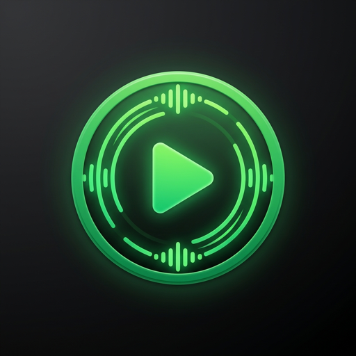
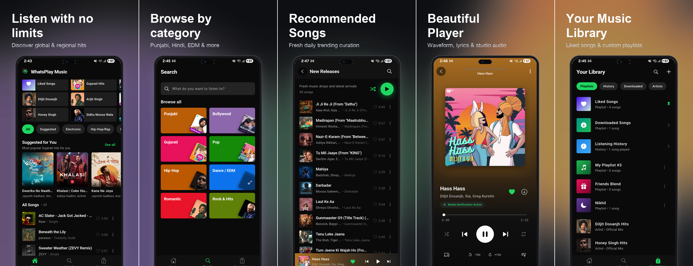
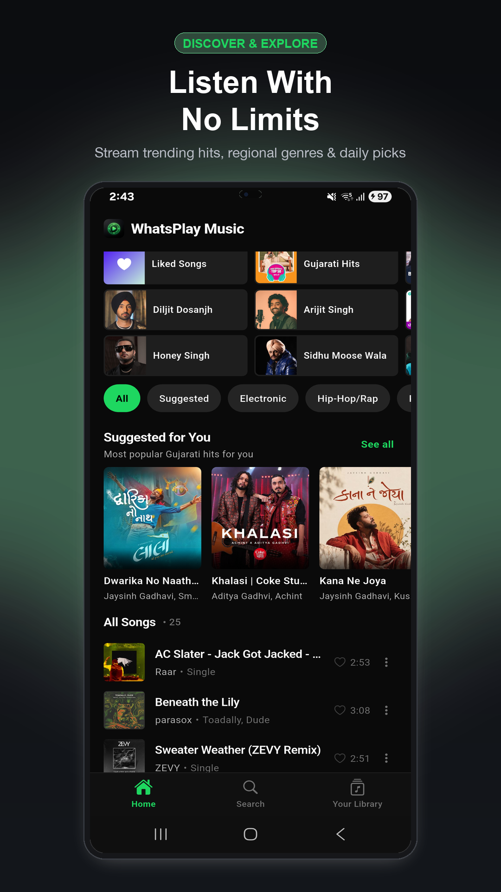
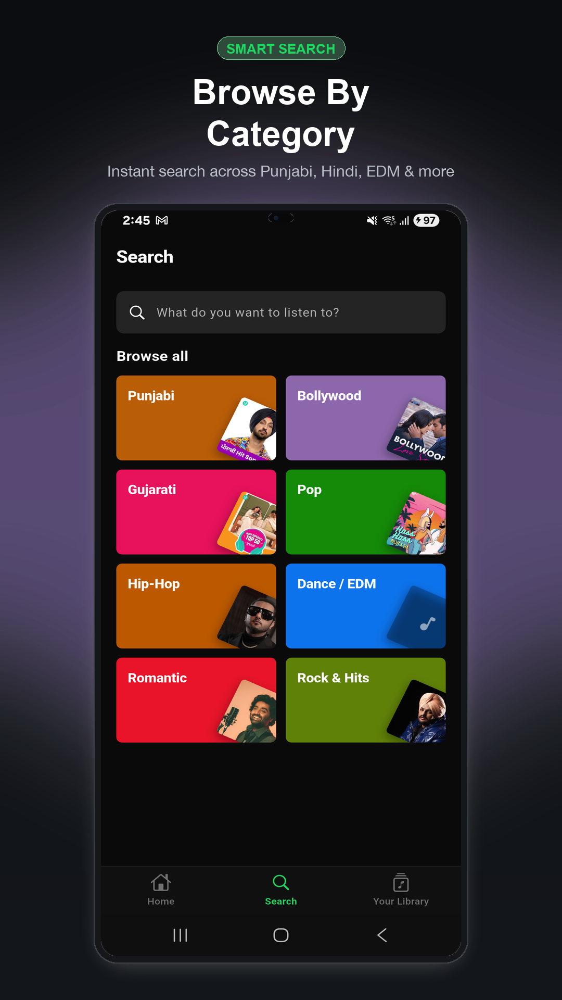
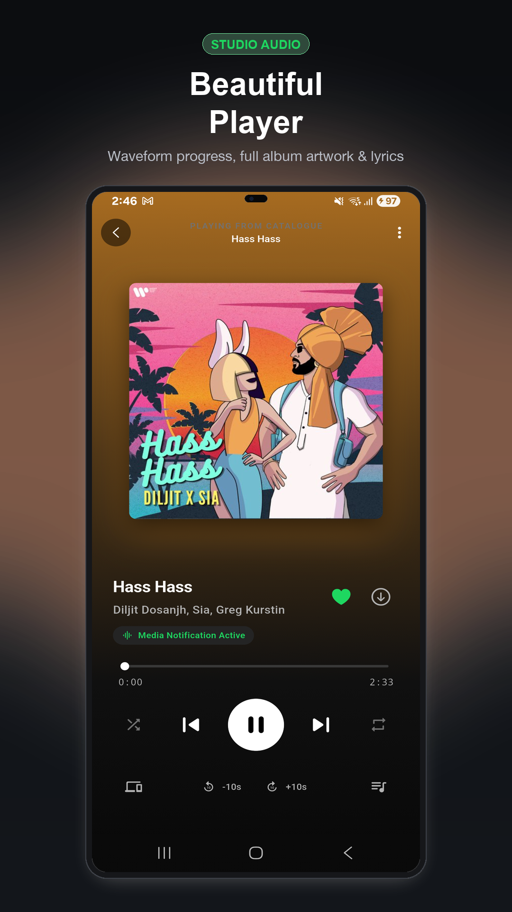
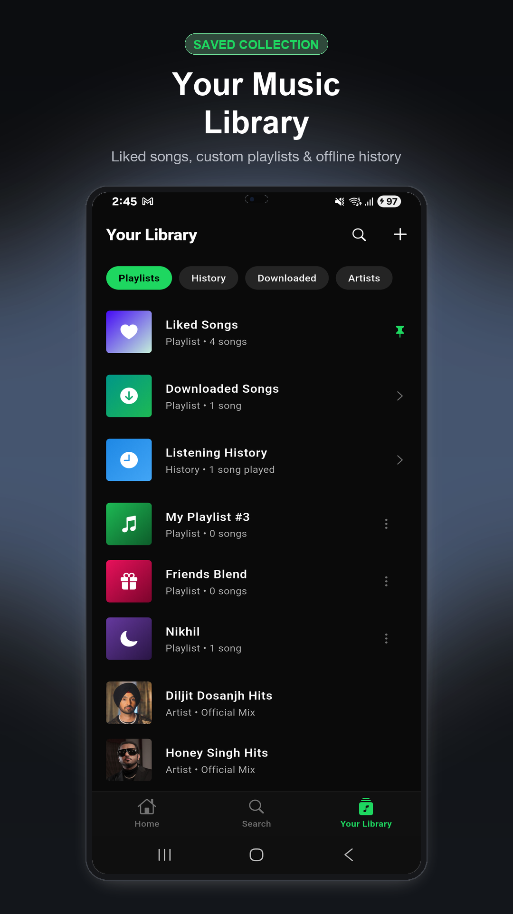
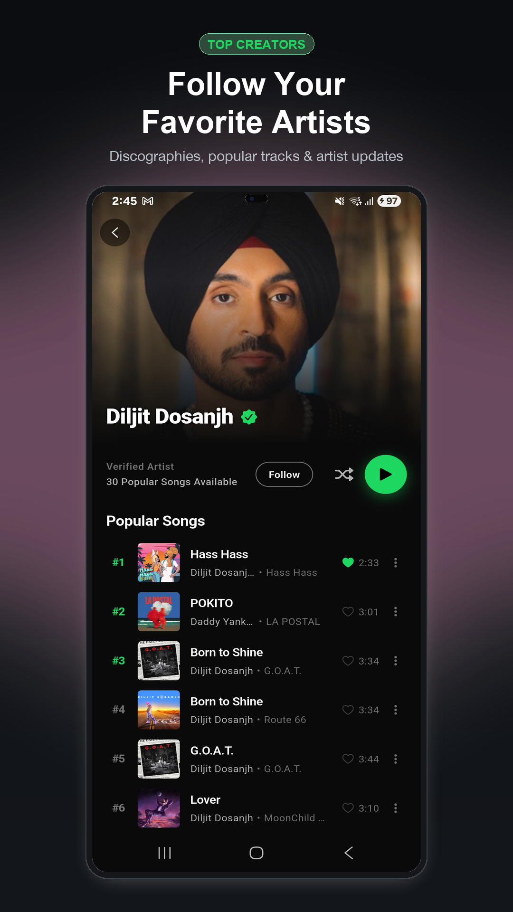
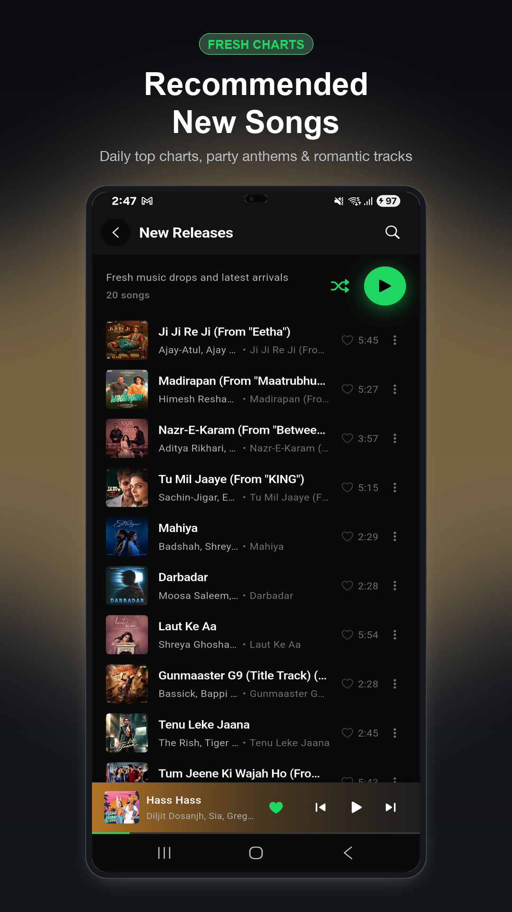

# WhatsPlay 🎵 – Open-Source Flutter Music Streaming & Player App

<p align="center">
  
</p>

<p align="center">
  <strong>A high-performance, Spotify-inspired open-source music streaming application built with Flutter, featuring dual-engine audio playback, rich Indian regional music discovery, background audio services, and offline local caching.</strong>
</p>

<p align="center">
  <a href="https://github.com/nikhilxrstudio-ctrl/Whats_play/stargazers"></a>
  <a href="https://github.com/nikhilxrstudio-ctrl/Whats_play/network/members"></a>
  <a href="https://flutter.dev"></a>
  <a href="https://dart.dev"></a>
  <a href="LICENSE"></a>
</p>

<p align="center">
  <a href="CHANGELOG.md"></a>
  <a href="https://nikhilxrstudio-ctrl.github.io/Whats_play/?source=GitHub+README&download=1"></a>
  <a href="https://nikhilxrstudio-ctrl.github.io/Whats_play/"></a>
</p>

<p align="center">
  
</p>

---

## 📥 Download Release APK (Android)

Get the latest optimized release APK directly on your Android device:

| Package | Architecture | Size | Download Link |
| :--- | :--- | :--- | :--- |
| **WhatsPlay.apk (Latest v1.0.15)** | `arm64-v8a` (99% Modern Android Phones) | **29.4 MB** | [⬇️ **Download WhatsPlay.apk**](https://nikhilxrstudio-ctrl.github.io/Whats_play/?source=GitHub+README&download=1) <br><sub>[Direct Link](https://github.com/nikhilxrstudio-ctrl/Whats_play/raw/main/downloads/WhatsPlay.apk)</sub> |
| **Official Web Landing Page** | Live Site | N/A | [🌐 **Visit Website**](https://nikhilxrstudio-ctrl.github.io/Whats_play/) |
| **Changelog & Version History** | All Releases | N/A | [📋 **View CHANGELOG.md**](CHANGELOG.md) |

> 📱 **Installation Tip**: On Android devices, when installing the downloaded APK, simply tap *"Allow from this source"* if prompted by your browser or file manager.

---

## 📌 Table of Contents

- [Download Release APK](#-download-release-apk-android)
- [Overview & Value Proposition](#-overview--value-proposition)
- [Why WhatsPlay?](#-why-whatsplay)
- [Key Features](#-key-features)
  - [Dual-Engine Music Streaming](#1-dual-engine-music-streaming)
  - [Regional & Global Music Discovery](#2-regional--global-music-discovery-bollywood-punjabi-gujarati)
  - [Spotify-Inspired Home & Hero Sections](#3-spotify-inspired-home--hero-sections)
  - [Full-Screen Player with Ambient Gradients](#4-full-screen-music-player-with-ambient-gradients)
  - [Background Audio & Lock Screen Notifications](#5-background-playback--system-media-notifications)
  - [Offline Music & SQLite Library](#6-offline-library--sqlite-persistence)
  - [Cross-Device Typography Scaling](#7-cross-device-typography-scaling)
  - [Real-Time Shared Blend Music](#8-real-time-shared-blend-music)
  - [Onboarding & Personalized Home Discovery](#9-onboarding--personalized-home-discovery)
- [Architecture & Tech Stack](#-architecture--tech-stack)
- [Screenshots & UI Walkthrough](#-screenshots--ui-walkthrough)
- [Prerequisites & Development Setup](#-prerequisites--development-setup)
- [Installation Guide](#-installation-guide)
- [Automated Testing & Static Analysis](#-automated-testing--static-analysis)
- [API Integrations & Credits](#-api-integrations--credits)
- [Roadmap & Future Enhancements](#-roadmap--future-enhancements)
- [Contributing Guidelines](#-contributing-guidelines)
- [License & Contact](#-license--contact)

---

## 💡 Overview & Value Proposition

**WhatsPlay** is an open-source Flutter music streaming project engineered for music lovers, mobile developers, and open-source contributors looking for a clean, privacy-focused, and extensible music application.

While commercial streaming services often impose heavy DRM restrictions, intrusive audio advertisements, and rigid closed ecosystems, WhatsPlay provides:
- **Clean Source Code**: Built using the Model-View-ViewModel (MVVM) architecture with the Repository pattern and GetX state management.
- **Dual Streaming Engines**: Combines legitimate regional streaming feeds (JioSaavn content endpoints) with decentralized open audio protocols (Audius REST API).
- **Zero Paywalls**: Completely free to explore, clone, study, and customize for personal listening and open-source learning.
- **Modern User Experience**: A dark-mode Spotify-like interface featuring animated wave equalizers, dynamic album color extraction, and lock-screen system media notifications.

---

## ⚡ Why WhatsPlay?

| Feature | Typical Music Player Apps | WhatsPlay Flutter App |
| :--- | :--- | :--- |
| **Streaming Sources** | Single API or offline-only files | **Dual-Engine (JioSaavn + Audius)** |
| **Regional Music** | Limited or locked behind subscriptions | **Rich Bollywood, Punjabi, & Gujarati Feeds** |
| **Background Playback** | Often paused when screen locks | **Full `audio_service` with Lock Screen controls** |
| **Offline Caching** | Proprietary encrypted formats | **Local SQLite database + Sandbox MP3 caching** |
| **UI Aesthetics** | Basic stock widgets | **Spotify-inspired dark theme with hero headers** |
| **Code Architecture** | Monolithic single-file controllers | **Clean MVVM + Repository pattern with 35 tests** |
| **Font Consistency** | Distorts across different screen sizes | **Locked ScreenUtil scaling with `noScaling` text** |

---

## 🚀 Key Features

### 1. Dual-Engine Music Streaming
WhatsPlay integrates two independent music providers to ensure rich catalog diversity and uninterrupted streaming:
- **JioSaavn Official Feeds**: Direct access to Bollywood hits, Punjabi chartbusters, Gujarati folk & contemporary songs, Taaza Tunes (New Releases), and India Superhits Top 50.
- **Audius Protocol**: Access to high-bitrate, full-track global streams spanning electronic, lo-fi beats, hip-hop, ambient, and indie music directly over `audio/mpeg` without 30-second truncations.

### 2. Regional & Global Music Discovery (Bollywood, Punjabi, Gujarati)
- **Curated Regional Feeds**: Dedicated categories for Gujarati Hits, Punjabi Top Hits, Bollywood Melodies, and Retro 90s Classics.
- **Artist Spotlights**: High-resolution profile headers and verified artist discographies for icons including *Diljit Dosanjh*, *Yo Yo Honey Singh*, *Arijit Singh*, *Sidhu Moose Wala*, and *Badshah*.
- **Top 50 Chartbusters**: A live ranked chart (#1 through #50) with numbered ranking badges to quickly play the most streamed songs in India.

### 3. Spotify-Inspired Home & Hero Sections
- **8-Item Quick Access Grid**: Fast one-tap jumping to favorite artists and hit playlists with live CDN artwork badges.
- **Horizontal Curated Shelves**:
  - *Taaza Tunes* (Brand new drops & fresh arrivals)
  - *Romantic Melodies* (Love ballads & acoustic songs)
  - *Party & Dance Anthems* (High-voltage club & festival bangers)
- **Personalized Recommendations**: *Suggested For You* dynamic shelf computed from your listening frequency and recent history.
- **Hero Headers on Section Views**: Tapping *"See all"* opens full section views with high-resolution hero art, stretch zoom effects, and collapsed top app bar transitions.
- **Sticky Category Bar**: Smooth pinned horizontal chip filter for switching genres (All, Electronic, Hip-Hop/Rap, Pop, Rock, Ambient, etc.).

### 4. Full-Screen Music Player with Ambient Gradients
- **Dynamic Backdrop Extraction**: The player background dynamically transitions to match dominant color hues extracted directly from the current song's album art.
- **Interactive Scrubber**: Real-time seekbar with smooth position tracking, buffering indicator, and duration timestamps.
- **Gesture Control**: Swipe left or right directly on the large 500x500 album art to seamlessly switch to the next or previous track.
- **Equalizer & Playback Modes**: Animated audio wave equalizer bars, repeat modes (Off, Repeat All, Repeat One), shuffle queueing, and ±10s fast rewind/forward buttons.

### 5. Background Playback & System Media Notifications
- **Background Audio Engine**: Powered by `audio_service` and `just_audio` to keep audio streaming smoothly even when switching apps or locking your smartphone screen.
- **Native Lock Screen Notifications**: Full native notification drawer controls showing track title, artist name, high-resolution album artwork, progress bar, play/pause, and skip controls.
- **Docked Mini-Player Bar**: Persistent bottom mini-player bar enabling one-tap expansion and swipe-to-skip functionality while browsing.

### 6. Offline Library & SQLite Persistence
- **Liked Songs**: Instant heart toggle backed by local SQLite persistence for instant startup.
- **Offline Download Manager**: Cache songs directly into the local app sandbox for playback without an active internet connection.
- **Custom Playlists**: Create, rename, and delete personal playlists and organize your audio collections.
- **Listening History**: Automatically records songs listened to for 10+ seconds, grouped by timeline (*Today*, *Yesterday*, *Earlier*).

### 7. Cross-Device Typography Scaling
- Configured using `flutter_screenutil` with custom non-scaling text scalers (`TextScaler.noScaling`) and a baseline 375x812 design viewport.
- Ensures identical font sizes, proportions, and spacing across small phones, flagship devices, and tablets without system font distortion.

### 8. Real-Time Shared Blend Music
- **Unique Join Codes**: Generate unique 6-character uppercase codes for each Blend. Share code with friends to join effortlessly.
- **Real-Time Collaboration**: Powered by Cloud Firestore real-time snapshot listeners. Tracks added by either user instantly reflect on both devices with creator attribution ("Added by [Name]").
- **Real-Time Now-Playing Indicators**: Active songs display with Spotify green titles, animated audio wave equalizer overlays on artwork, and synced playback.
- **Instant Search Debounce**: Fast 350ms debounced search when adding tracks to Blends without requiring software keyboard confirmation.
- **User Activity & Telemetry**: Securely stores profiles, device telemetry, and blend history for future dashboard integration.

### 9. Onboarding & Personalized Home Discovery
- **2-Step Onboarding with Progress Bar**: First-time users are greeted with a smooth 2-step setup to enter their name and select their favorite music vibes with emojis (*Bollywood, Punjabi, Gujarati, Romantic, Party, Pop, Lo-Fi, etc.*).
- **Zero-Friction Blend Joining**: Because guests establish their display name during onboarding, joining a Blend later requires zero typing—just enter the 6-character code and join instantly.
- **Pinned Home Filter Pills**: Pinned right beneath the Home top app bar, filter pills display "All" along with the user's favorite genres selected during onboarding. Selecting any pill dynamically filters songs for that genre, while "All" restores the full rich multi-shelf layout.

---

## 🛠️ Architecture & Tech Stack

WhatsPlay follows the **MVVM + Repository Pattern** to separate data access, business logic, and UI rendering:

```
┌────────────────────────────────────────────────────────┐
│                      Data Sources                      │
│        JioSaavn API Feeds   │   Audius REST Stream      │
└─────────────────────────────┬──────────────────────────┘
                              │
                              ▼
┌────────────────────────────────────────────────────────┐
│                     Service Layer                      │
│      SaavnService      │   AudiusService (IApiService) │
│      LocalDatabaseService (SQLite) │ AudioPlayerHandler │
└─────────────────────────────┬──────────────────────────┘
                              │
                              ▼
┌────────────────────────────────────────────────────────┐
│                   Repository Layer                     │
│    MusicRepository (implements IMusicRepository)       │
└─────────────────────────────┬──────────────────────────┘
                              │
                              ▼
┌────────────────────────────────────────────────────────┐
│                   Controller Layer                     │
│  MusicController │ PlayerController │ ArtistDetailCtrl │
│    SectionTracksController │ CategoryDetailController  │
└─────────────────────────────┬──────────────────────────┘
                              │
                              ▼
┌────────────────────────────────────────────────────────┐
│                       UI Layer                         │
│  MusicCatalogueScreen │ MusicPlayerScreen │ MiniPlayer │
│     SectionTracksScreen │ ArtistDetailScreen           │
└────────────────────────────────────────────────────────┘
```

### Libraries & Packages

- **State Management & Routing**: [`get: ^4.7.3`](https://pub.dev/packages/get)
- **Audio Playback**: [`just_audio: ^0.10.6`](https://pub.dev/packages/just_audio)
- **Background Media Services**: [`audio_service: ^0.18.19`](https://pub.dev/packages/audio_service)
- **Local Persistence & SQLite**: [`sqflite: ^2.4.2+1`](https://pub.dev/packages/sqflite), [`shared_preferences: ^2.5.6`](https://pub.dev/packages/shared_preferences)
- **Responsive Screen Adaptation**: [`flutter_screenutil: ^5.9.3`](https://pub.dev/packages/flutter_screenutil)
- **Networking**: [`http: ^1.6.0`](https://pub.dev/packages/http)
- **Decryption & Utilities**: [`dart_des: ^1.0.2`](https://pub.dev/packages/dart_des), [`intl: ^0.20.3`](https://pub.dev/packages/intl)

---

## 📱 Screenshots & UI Walkthrough

<p align="center">
  
</p>

### 📸 Google Play Store Feature Mockups

| 🎧 Listen With No Limits | 🔍 Browse By Category | 🎵 Studio Music Player |
| :---: | :---: | :---: |
|  |  |  |
| *Home & Regional Discovery* | *Genre Search & Recommendations* | *Waveform & Full Controls* |

| 📚 Your Music Library | ⭐ Follow Top Artists | 🔥 Recommended Hits |
| :---: | :---: | :---: |
|  |  |  |
| *Liked Songs & Offline Playlists* | *Verified Artist Discography* | *Taaza Tunes & Fresh Charts* |

---

## 💻 Prerequisites & Development Setup

Before building the application, ensure you have the following installed on your machine:

- **Flutter SDK**: Version `3.24.0` or higher (tested with Flutter `3.41.8`).
- **Dart SDK**: Version `3.11.5` or higher.
- **FVM (Flutter Version Management)** *(Recommended)*: Pinned to version `3.41.8` in `.fvmrc`.
- **Android Studio** (for Android builds) with Android SDK platform-tools.
- **Xcode** (for macOS & iOS builds) with CocoaPods installed.

---

## 🚀 Installation Guide

### Step 1: Clone the Repository

```bash
git clone https://github.com/nikhilxrstudio-ctrl/Whats_play.git
cd Whats_play
```

### Step 2: Install SDK via FVM (Optional but Recommended)

```bash
# If using FVM
fvm install
fvm use 3.41.8
```

### Step 3: Install Flutter Dependencies

```bash
# Using standard Flutter
flutter pub get

# Or using FVM
fvm flutter pub get
```

### Step 4: Run the Application

```bash
# Run on connected physical device or emulator
flutter run

# Or target specific platforms
flutter run -d chrome
flutter run -d macos
```

---

## 🧪 Automated Testing & Static Analysis

The repository maintains high code quality with static analysis and comprehensive test suites covering unit, controller, and widget layers:

```bash
# 1. Run static code analysis
flutter analyze

# 2. Run the complete automated test suite (35 passing tests)
flutter test test/controllers/ test/widget_test.dart
```

### Covered Test Suites:
- `track_model_test.dart`: Serialization, duration parsing, and stream link extraction.
- `saavn_service_test.dart`: Search parsing, media link decryption, and playlist feeds.
- `audius_service_test.dart`: Open protocol API endpoints and stream verification.
- `local_database_service_test.dart`: SQLite CRUD for liked tracks, playlists, and history.
- `player_controller_test.dart`: Audio queue traversal, shuffle, repeat, like persistence, and 10s listening detection.
- `music_controller_test.dart`: Shelf population, category filtering, and error state transitions.
- `widget_test.dart`: MusicCatalogueScreen navigation, mini-player swipe, and back button behaviors.

---

## 🤝 API Integrations & Credits

WhatsPlay acknowledges and gives credit to the following platforms for making music discovery possible:
- **[Audius Protocol](https://audius.co)**: Open-source, decentralized music streaming protocol providing legal, artist-distributed audio streams without developer fees.
- **JioSaavn Public Data Services**: Legitimate regional media endpoints providing rich Indian music catalog metadata and stream feeds.
- **[Flutter Community](https://flutter.dev)**: For outstanding open-source packages including `just_audio`, `audio_service`, `get`, and `flutter_screenutil`.

---

## 🗺️ Roadmap & Future Enhancements

- [x] Dual-engine streaming integration (JioSaavn & Audius).
- [x] Spotify-style dark theme with animated equalizers.
- [x] Background audio with native OS notification drawer controls.
- [x] Local SQLite caching for playlists, likes, and offline songs.
- [x] Section Hero headers with smooth scroll animations.
- [ ] Synchronized LRC lyric display on full player view.
- [ ] Sleep timer toggle with custom countdown.
- [ ] Audio equalizer with preset sound profiles (Bass Boost, Vocal, Rock).
- [ ] Multi-language user interface localization (Hindi, Gujarati, English).

---

## 👥 Contributing Guidelines

Contributions, issues, and feature requests are welcome!
To contribute:
1. **Fork the Project**: Click the Fork button at the top right of this page.
2. **Create a Feature Branch**: `git checkout -b feature/AmazingFeature`
3. **Commit Your Changes**: `git commit -m 'feat: Add some AmazingFeature'`
4. **Push to the Branch**: `git push origin feature/AmazingFeature`
5. **Open a Pull Request**: Submit your PR with a clear description of changes.

Please ensure all tests pass (`flutter test`) and `flutter analyze` reports zero issues before opening a pull request.

---

## 📄 License & Contact

Distributed under the **MIT License**. See `LICENSE` for more information.

- **Developer**: Nikhil
- **Repository**: [https://github.com/nikhilxrstudio-ctrl/Whats_play](https://github.com/nikhilxrstudio-ctrl/Whats_play)
- **Issues & Discussions**: [GitHub Issues Page](https://github.com/nikhilxrstudio-ctrl/Whats_play/issues)

---

<p align="center">
  Made with ❤️ using <strong>Flutter</strong> & <strong>Dart</strong>
</p>
